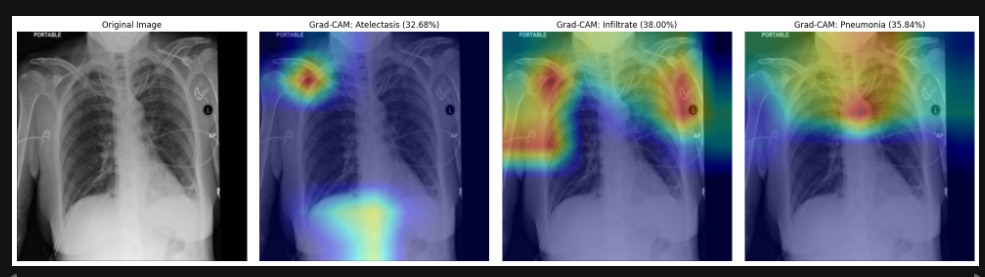

# Chest X-ray Classification and Localization

This project is a Jupyter notebook that trains and evaluates a multi-label chest X-ray classifier on the local NIH ChestX-ray data subset with bounding-box annotations. It also uses Grad-CAM to visualize image regions associated with model predictions and compares those regions with the available bounding boxes.

The project is for coursework and experimentation. Its predictions and localization scores are not intended for clinical use.

## Quick start: run the desktop app

If `final_model.keras` and the `.venv310` environment are already present, open PowerShell in this project folder and run:

```powershell
.\.venv310\Scripts\python.exe app.py
```

In the app, click **Choose X-ray**, select a PNG, JPEG, BMP, or TIFF file, and wait for the prediction and Grad-CAM overlay. The app expects `final_model.keras` beside `app.py`. If the environment or model is missing, follow the setup and training steps below first.

## Example Grad-CAM output

The app can display the original chest X-ray alongside Grad-CAM overlays for the model's predicted findings:



## Project contents

| Path | Purpose |
| --- | --- |
| `CV_CA1 (1).ipynb` | Data preparation, model training, evaluation, Grad-CAM, and custom-image inference |
| `app.py` | Small Windows desktop app for image prediction and Grad-CAM |
| `Data_Entry_2017.csv` | Image-level NIH findings and metadata |
| `BBox_List_2017.csv` | Ground-truth bounding boxes for selected findings |
| `bbox_img/` | Local chest X-ray images that have box annotations |
| `best_model.keras` | Best checkpoint saved by a training phase; later phases may overwrite it |
| `final_model.keras` | Model saved by the notebook for later use |
| `.venv310/` | Project's Python 3.10 environment for TensorFlow DirectML |

The notebook checks that the CSV files and `bbox_img/` are next to it. It filters the label table to image files available in that folder. This workspace currently contains 880 such images, so the notebook trains on that local subset rather than the full NIH image collection.

## Start here: setup, train, and run a prediction

These numbered steps take you from a fresh checkout to using the desktop app. Skip environment creation and model training if you already have a working `.venv310` environment and `final_model.keras`. Notebook training can take a long time, especially on CPU.

### 1. Check the project files

Keep these items in the same project folder:

- `CV_CA1 (1).ipynb` and `app.py`
- `Data_Entry_2017.csv` and `BBox_List_2017.csv`
- the `bbox_img/` folder containing the X-ray images

The model file `final_model.keras` is created by notebook training. This project currently has 880 annotated images available in `bbox_img/`; the full NIH dataset is not included.

### 2. Create the Python environment

On 64-bit Windows, install Python 3.10 if needed, then open PowerShell in the project folder. Create and prepare the virtual environment:

```powershell
py -3.10 -m venv .venv310
.\.venv310\Scripts\python.exe -m pip install --upgrade pip
.\.venv310\Scripts\python.exe -m pip install ipykernel jupyterlab
.\.venv310\Scripts\python.exe -m ipykernel install --user --name cv-ca-directml --display-name "Python 3.10 (TensorFlow DirectML)"
```

The notebook's first setup cell installs TensorFlow DirectML and the project libraries into the active kernel. To use the desktop app immediately, install those packages from PowerShell as well (or run the notebook setup cell first):

```powershell
.\.venv310\Scripts\python.exe -m pip install tensorflow-cpu==2.10 tensorflow-directml-plugin numpy==1.23.5 pandas scikit-learn scikit-multilearn iterative-stratification pillow matplotlib opencv-python==4.11.0.86
```

Do not install regular `tensorflow` alongside `tensorflow-cpu` and the DirectML plugin. On a compatible Windows GPU, DirectML can accelerate TensorFlow; the app can also run with CPU support, though inference and training may be slower.

### 3. Train and save the model

Launch Jupyter Lab:

```powershell
.\.venv310\Scripts\python.exe -m jupyter lab
```

Open `CV_CA1 (1).ipynb`, choose **Kernel > Change Kernel > Python 3.10 (TensorFlow DirectML)**, and restart the kernel. Run the notebook from the first cell in order (in Jupyter, use **Run > Run All Cells**). The setup cell installs dependencies and checks the Python version. The notebook then loads the CSV metadata and local images, builds the labels and splits, trains the models, and runs the evaluation and Grad-CAM sections. Allow the first run to download ImageNet weights if prompted by TensorFlow.

The training workflow saves `best_model.keras` checkpoints and writes `final_model.keras` in the project working directory. Wait for the save cell to finish before closing the notebook. If a training run stops before that save cell, the app may not have a usable final model.

### 4. Open the desktop app

After `final_model.keras` exists, launch the app from the project folder:

```powershell
.\.venv310\Scripts\python.exe app.py
```

Select **Choose X-ray**, choose a PNG, JPEG, BMP, or TIFF image, and wait for analysis. The top finding and its score appear above the image panes; all eight scores appear at right, and the Grad-CAM overlay appears beside the selected X-ray. Select another image to run another prediction. The first prediction may take longer while TensorFlow loads the saved model.


## Environment

The DirectML TensorFlow plugin used here requires 64-bit Windows Python 3.10 and TensorFlow 2.10. Use the registered **Python 3.10 (TensorFlow DirectML)** kernel. The notebook has an early guard that stops if another Python version is active.

The project environment is `.venv310`. If it has not been created, create it with a Python 3.10 installation:

```powershell
py -3.10 -m venv .venv310
```

Install and register the kernel from the project folder:

```powershell
.\.venv310\Scripts\python.exe -m pip install --upgrade pip
.\.venv310\Scripts\python.exe -m pip install ipykernel
.\.venv310\Scripts\python.exe -m ipykernel install --user --name cv-ca-directml --display-name "Python 3.10 (TensorFlow DirectML)"
```

In Jupyter, choose **Kernel → Change Kernel → Python 3.10 (TensorFlow DirectML)** and restart it. Run the first setup cell; it installs the notebook dependencies into the selected kernel, including:

- `tensorflow-cpu==2.10` and `tensorflow-directml-plugin`
- `numpy==1.23.5`, pandas, scikit-learn, and scikit-multilearn
- Pillow, Matplotlib, and `opencv-python==4.11.0.86`
- `iterative-stratification`

Do not install the regular `tensorflow` package alongside the DirectML packages. The notebook uses the `tensorflow-cpu` package as the TensorFlow 2.10 base and the DirectML plugin to expose the GPU.

To check the environment from PowerShell:

```powershell
.\.venv310\Scripts\python.exe -c "import sys, tensorflow as tf; print(sys.version); print(tf.__version__); print(tf.config.list_physical_devices('GPU'))"
```

The expected TensorFlow version is `2.10.0`; on a compatible Windows GPU setup, the last line should include a GPU device. If the first notebook cell reports Python 3.14 or another version, the notebook is still attached to the wrong active kernel. Change the kernel and restart it before running the notebook again.

## Data and label preparation

The notebook uses eight findings that have bounding-box labels:

1. Atelectasis
2. Cardiomegaly
3. Effusion
4. Infiltrate
5. Mass
6. Nodule
7. Pneumonia
8. Pneumothorax

The NIH image labels call one class `Infiltration`, while the box CSV uses `Infiltrate`; the notebook maps the classifier's `Infiltrate` class to the NIH `Infiltration` label when building the target vector. Each image receives an eight-element multi-hot label vector, since an image can have multiple findings.

The notebook uses iterative multi-label stratification to create approximately 70% training, 15% validation, and 15% test splits. It reports the per-class counts for each split. The split is based on the images available locally and may differ if the available image set changes.

## Model and notebook workflow

Run `CV_CA1 (1).ipynb` from the first cell in order. Its main stages are:

1. **Load and inspect data** — read both CSV files, normalize the bounding-box column names, find local image files, filter labels to those files, and summarize class counts.
2. **Create train, validation, and test sets** — build the eight-label matrix and perform iterative stratified splitting.
3. **Load images in batches** — a Keras `Sequence` reads images from disk, converts them to RGB, resizes them to 224 × 224, and scales pixel values to 0–1.
4. **Train DenseNet121 classifiers** — use an ImageNet-pretrained DenseNet121 backbone with global average pooling, dropout, and an eight-output sigmoid layer. Training uses binary cross-entropy and multi-label AUC. The notebook contains two sequential experiments: an initial transfer-learning run, followed by a fresh model whose training images receive random horizontal flips and small rotations. Early stopping and checkpoints are used in the training phases.
5. **Evaluate** — report overall AUC and per-class ROC-AUC on the held-out test split.
6. **Explain predictions and assess localization** — compute Grad-CAM heatmaps, overlay them on X-rays, and compare thresholded heatmaps with ground-truth boxes using intersection over union (IoU).
7. **Run optional custom-image inference** — set `custom_image_path` in the interactive inference cell to an image file, then run that cell to print class probabilities and display Grad-CAM overlays.

Running all cells performs the training phases in sequence and can take considerable time. The notebook may download DenseNet121 ImageNet weights the first time it runs. The displayed metrics and heatmaps depend on the trained weights and the current data split.

## How a prediction works

The desktop app loads `final_model.keras` once and reuses it while the app stays open. For each chosen file, it converts the image to RGB, resizes it to 224 ? 224 pixels, and scales pixel values to the 0?1 range used during training. DenseNet121 and the trained classification head produce eight sigmoid scores, one per finding. Because this is a multi-label model, several findings can have high scores at once. The app highlights the largest score as the top finding; it does not use the notebook's 50% threshold to hide scores.

The Grad-CAM panel explains the top-scoring output. It uses gradients of that class score with respect to the final DenseNet feature map, turns those gradients into a coarse heatmap, and overlays the heatmap on the resized X-ray. A brighter region indicates stronger influence on that model output. It does not prove that the highlighted area is medically relevant or that the prediction is correct.

## Simple desktop frontend

The detailed setup and launch steps are in [Start here: setup, train, and run a prediction](#start-here-setup-train-and-run-a-prediction). The app uses Tkinter, Pillow, OpenCV, and TensorFlow from the notebook environment; it does not require a separate web framework.

## Predict from an unlabeled image

The notebook has a **Predict from an unlabeled image** section at the end. Run that cell to open a native Windows file chooser and select a supported image. The cell then displays the image and predictions inline and finishes when inference is complete. It reuses the trained model in memory, or loads `final_model.keras` after a kernel restart. A CSV row or ground-truth label is not needed.

The cell previews the image, resizes it to 224 × 224, converts it to RGB, applies the same 0–1 pixel scaling used during training, and displays probabilities for all eight findings. It also displays a Grad-CAM overlay for the highest-scoring finding. Findings at or above the default 50% threshold are listed as predicted. Change `PREDICTION_THRESHOLD` or `PREDICTION_MODEL_PATH` in the cell to use a different cutoff or another saved model such as `best_model.keras`.

If no score reaches the threshold, the cell says so; this should not be interpreted as a normal-image diagnosis. The scores are model outputs, not medically calibrated probabilities.

## Improving prediction confidence

A higher model score does not automatically mean a more reliable prediction. The current notebook uses 880 locally available images, and its scores are not calibrated for clinical interpretation. These steps can make evaluation and displayed confidence more dependable:

- **Use more representative labeled data.** The current local subset is small, especially for less common findings. More images from varied sources can help the model learn patterns that generalize.
- **Split by patient.** Keep all images from a patient in only one of the training, validation, or test sets. The current iterative multi-label split uses images; patient-level splitting helps prevent related images from making test performance look overly optimistic.
- **Evaluate each finding separately.** Alongside AUC, report sensitivity, specificity, and precision per class on a held-out test set. Select operating thresholds using the validation set, then evaluate once on the test set. Include confidence intervals to show uncertainty from the small sample.
- **Calibrate predicted scores.** Check calibration curves on held-out validation data: for example, among predictions near 70%, roughly 70% should be positive for that finding. If scores are poorly calibrated, consider temperature scaling or isotonic regression fit on validation data, and assess calibration again on test data.
- **Check robustness.** Evaluate on data from a different source or hospital and across view positions and relevant subgroups. Flag poor-quality or out-of-distribution images for review.
- **Show uncertainty and request review.** Use calibrated scores and validation-based thresholds. Mark uncertain or out-of-distribution cases for review rather than treating the default 50% cutoff as definitive.

For this coursework model, prioritize patient-level splitting, a truly held-out test set, and per-class calibration. Grad-CAM shows image regions associated with a prediction; it does not verify that the prediction is correct. These steps improve evaluation, but do not make this project suitable for clinical decisions.

## Outputs

- `best_model.keras` is written by `ModelCheckpoint` during fine-tuning. The later experiment writes to the same filename and can replace the earlier checkpoint.
- `final_model.keras` is written by the notebook's save cell after the later training workflow.
- Plots, confusion-independent AUC summaries, sample heatmaps, and IoU tables are displayed in the notebook; the notebook does not save those figures as separate image files by default.

## How the localization score is calculated

Grad-CAM uses the final DenseNet feature activation to produce a coarse importance map, which is resized to the input image dimensions. The notebook thresholds the normalized heatmap at 0.5, scales the CSV box coordinates from the original 1024-pixel image space to 224 × 224, and calculates IoU between the predicted region and the box mask.

The final trust report only includes boxed classes for images that are both positive in the ground-truth labels and above the model's prediction threshold. It is therefore a conditional localization summary, not a measure over every image or every box. Grad-CAM is an explanatory visualization and does not establish that the model has learned a medically valid reason for its prediction.

## Notes and limitations

- Only locally available annotated images are used; the full NIH dataset is not included in this project directory.
- Results from this small annotated subset may not generalize to the full dataset or other populations.
- IoU is calculated only where the class is boxed and predicted positive, and its value depends on the selected heatmap threshold.
- DenseNet121 is pretrained on ImageNet, not on a dedicated clinical imaging dataset.
- Model evaluation and Grad-CAM results are educational research outputs, not diagnostic advice.
